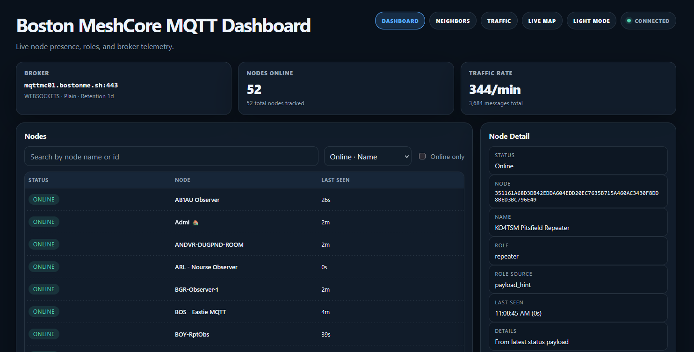

<h1 align="center">MeshCore MQTT Dashboard</h1>

<p align="center">
  Live MeshCore node activity, neighbor topology, and traffic analysis.<br />
  Self-hosted, with real-time updates from your MQTT broker.
</p>

<p align="center">
  <a href="https://github.com/yellowcooln/meshcore-mqtt-dashboard/releases"></a>
  <a href="https://github.com/yellowcooln/meshcore-mqtt-dashboard/actions/workflows/tests.yml?query=branch%3Amain"></a>
  <a href="https://github.com/yellowcooln/meshcore-mqtt-dashboard/actions/workflows/docker-publish.yml?query=branch%3Amain"></a>
  <a href="https://hub.docker.com/r/yellowcooln/meshcore-mqtt-dashboard"></a>
</p>

<p align="center">
  <a href="https://mcmqttdashboard.bostonme.sh/">Live demo</a> &middot;
  <a href="#quick-start">Quick start</a> &middot;
  <a href="#configuration">Configuration</a> &middot;
  <a href="./CHANGES.MD">Changelog</a> &middot;
  <a href="https://github.com/yellowcooln/meshcore-mqtt-dashboard/issues">Report an issue</a>
</p>



<p align="center"><em>A look at the Boston Mesh deployment. Connect your own broker and customize the dashboard for your mesh.</em></p>

## Features

- **Dashboard:** online nodes, device roles, packet inspection, and optional broker `$SYS` telemetry.
- **Traffic:** retained packet history, route/payload charts, top talkers, and burst activity.
- **Neighbors:** observer topology, SNR, last-heard ages, and a filterable link table.
- **Battery Info:** optional decoded battery telemetry from a configured channel.
- Shared light/dark themes and mobile layouts, with batched live updates and stable node sorting.

## Quick start

### Run the prebuilt Docker image

Prebuilt images are available on [Docker Hub](https://hub.docker.com/r/yellowcooln/meshcore-mqtt-dashboard)—no local build required:

- **`yellowcooln/meshcore-mqtt-dashboard:latest`** — production image from `main`.
- **`yellowcooln/meshcore-mqtt-dashboard:dev`** — development image from `dev`.

Install Docker with the Compose plugin, then download the configuration template into a new directory:

```bash
mkdir meshcore-mqtt-dashboard
cd meshcore-mqtt-dashboard
curl -fsSL https://raw.githubusercontent.com/yellowcooln/meshcore-mqtt-dashboard/main/.env.example -o .env
```

Edit `.env` with your broker address, credentials, and topics. `MQTT_HOST` must be reachable from the container; `localhost` refers to the container itself.

Create `docker-compose.yaml` alongside `.env`:

```yaml
services:
  mqtt-dashboard:
    image: yellowcooln/meshcore-mqtt-dashboard:latest
    ports:
      - "${WEB_PORT:-8081}:8081"
    env_file:
      - .env
    volumes:
      - ./data:/data
    restart: unless-stopped
```

Pull the image and start the dashboard:

```bash
docker compose pull
docker compose up -d
```

Open **http://localhost:8081**, or use your server's address and configured `WEB_PORT`. Keep the `./data` directory when updating; it holds persisted history and neighbor snapshots.

### Build from source instead

For local changes, clone the repository and use its included build-based Compose file:

```bash
git clone https://github.com/yellowcooln/meshcore-mqtt-dashboard
cd meshcore-mqtt-dashboard
cp .env.example .env
```

Configure `.env` as above, then build and start:

```bash
docker compose up -d --build
```

The dashboard is available at the same address and port described above.

## Configuration

Settings are loaded from `.env`. See [`.env.example`](./.env.example) for the complete list.

| Setting | Purpose |
| --- | --- |
| `MQTT_HOST`, `MQTT_PORT` | Broker connection address. |
| `MQTT_USERNAME`, `MQTT_PASSWORD` | Broker credentials, when required. |
| `MQTT_TOPIC` | Topic subscription; comma-separated topics are supported. |
| `MQTT_TRANSPORT`, `MQTT_WS_PATH` | TCP or WebSocket transport and WebSocket path. |
| `MQTT_TLS`, `MQTT_CA_CERT` | TLS connection settings. |
| `WEB_PORT`, `DASH_TITLE` | Web port and dashboard title. |
| `DASH_BROKER_HOST` | Display-only broker label; does not change the connection address. |
| `SYS_TOPICS_ENABLED` | Show or hide broker `$SYS` telemetry. |
| `PACKET_RETENTION_SECONDS` | Packet history retention, capped at 24 hours. |
| `DASH_API_TOKEN` | Optional protection for the HTTP data endpoints below. |
| `BATTERYINFO_ENABLED` | Enable Battery Info; disabled by default. |

Battery decoding also requires `BATTERYINFO_CHANNEL_NAME` and `BATTERYINFO_CHANNEL_KEY`. Battery history has its own retention setting, `BATTERYINFO_RETENTION_SECONDS`.

The `./data` volume stores packet history and the latest neighbor snapshots across restarts. Keep it when updating. Node presence repopulates from fresh MQTT traffic after a restart.

## Pages and API

| Path | Description |
| --- | --- |
| `/` | Node dashboard. |
| `/traffic` | Traffic analysis. |
| `/neighbors` | Neighbor graph and link table. |
| `/batteryinfo` | Battery telemetry, when enabled. |
| `/ws` | Public live WebSocket stream. |
| `/snapshot`, `/stats`, `/packets`, `/neighbors/data` | HTTP data endpoints. |

When `DASH_API_TOKEN` is set, HTTP data requests require an `X-Dashboard-Token` header, an `Authorization: Bearer <token>` header, or a `?token=<token>` query parameter. The token header name can be changed with `DASH_API_TOKEN_HEADER`.

**The pages and WebSocket stream remain public**, including neighbor topology. The API token does not make the dashboard private.

## Development

From the repository root:

```bash
pip install -r requirements-dev.txt
npm ci --prefix backend
pytest -q
```

Node.js is needed for decoder tests. Rebuild the local application with `docker compose up -d --build`.

## Star History

<a href="https://www.star-history.com/?repos=yellowcooln%2Fmeshcore-mqtt-dashboard&type=date&legend=top-left">
 <picture>
   <source media="(prefers-color-scheme: dark)" srcset="https://api.star-history.com/chart?repos=yellowcooln/meshcore-mqtt-dashboard&type=date&theme=dark&legend=top-left" />
   <source media="(prefers-color-scheme: light)" srcset="https://api.star-history.com/chart?repos=yellowcooln/meshcore-mqtt-dashboard&type=date&legend=top-left" />
   
 </picture>
</a>
